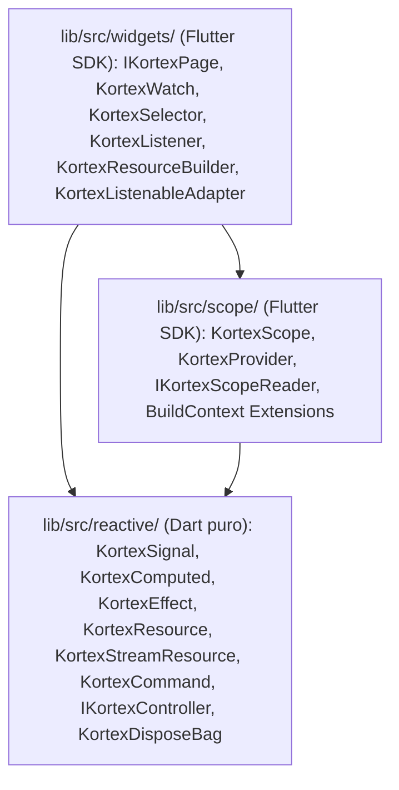
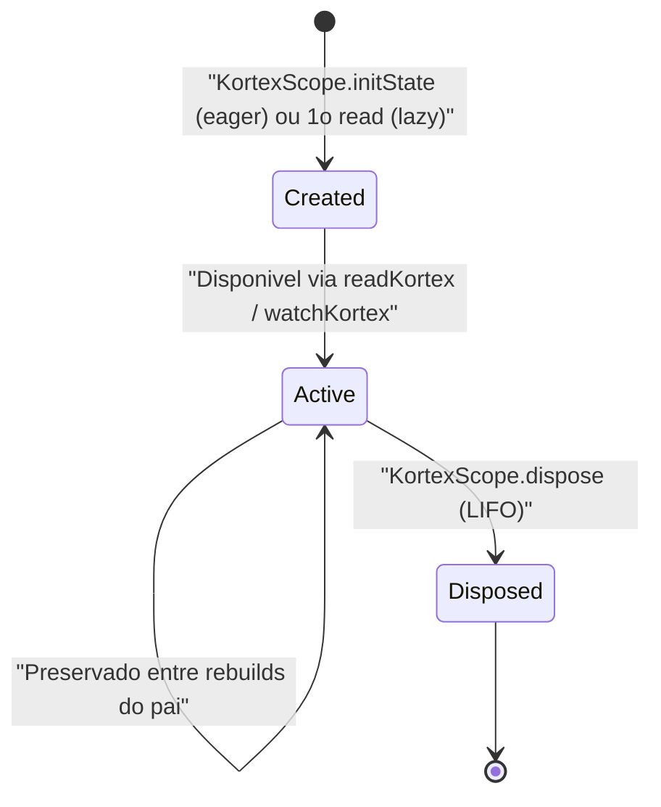

# Kortex (`v0.1.0`) — Especificação de Design & Arquitetura de Engenharia

> **Autor (Arquiteto)**: Denerson Nobre  
> **Versão**: `0.1.0` | **Data**: `2026-11-19`  
> **Referências**: [PRD.md](../product/PRD.md) · [SPEC.md](SPEC.md)

---

## 1. Princípios de Design & Decisões de Engenharia

- **Minimalismo sem mágica**: toda dependência entre camadas é explícita via construtor, `IKortexScopeReader` ou `BuildContext`.
- **Unidirecionalidade de dependências entre camadas**:
  - `widgets/` depende de `scope/` e `reactive/` + `package:flutter/widgets.dart`.
  - `scope/` depende de `reactive/` + `package:flutter/widgets.dart`.
  - `reactive/` depende **apenas** de `dart:async` e `dart:core` (zero imports de Flutter).
- **Uma única forma idiomática**: leitura via `.value` / `.peek()`, pattern matching em `IKortexAsyncState<T>` via `switch` do Dart 3, e inicialização de `IKortexController` exclusivamente no construtor.

---

## 2. Diagrama de Camadas & Fluxo Reativo

### Fluxo de Rastreamento & Batch

1. `KortexWatch`, `KortexSelector`, `KortexListener`, `KortexComputed` ou `KortexEffect` abre um escopo em `KortexTracker.runWithObserver(observer, fn, onTrack: ...)`.
2. Cada leitura `.value` em `KortexSignal` ou `KortexComputed` chama `KortexTracker.recordRead(this)`, conectando o nó ao observador ativo.
3. Leituras via `.peek()` ou `kortexUntracked(...)` ignoram `KortexTracker`.
4. Mutações dentro de `kortexBatch(() { ... })` acumulam observadores em fila deduplicada e notificam apenas ao sair do nível mais externo (`_batchDepth == 0`).

---

## 3. Contratos de Ciclo de Vida & Escopo

- **Resolução entre irmãos + Detecção de Ciclo (`INV-07`)**: `_KortexScopeState` mantém `_resolvingTypes` durante `create(scope)`. Reentrada no mesmo `Type` lança `StateError` com a cadeia do ciclo.
- **`KortexScope.capture`**: lê as instâncias visíveis nos escopos ancestrais do `BuildContext` chamador e cria um `KortexScope` sobre o modal/dialog usando `KortexProvider.value` (sem transferir posse de `dispose`).
- **Auto-dispose tipado**: se `KortexProvider.dispose` for omitido e a instância implementar `IKortexDisposable`, o `KortexScope` invoca `instance.dispose()`. Instâncias de `KortexProvider.value` nunca são descartadas pelo escopo.

---

## 4. Estados Canônicos de UI (`KortexResourceBuilder` & `example/`)

Todo componente assíncrono no app exemplo (`example/`) e no `KortexResourceBuilder<T>` trata os estados da união selada `IKortexAsyncState<T>`:

1. **Carregamento (`KortexAsyncLoading<T>`)**: exibe indicador de carga; quando `isRefreshing == true` (`previousValue != null`), mantém os dados anteriores visíveis com feedback discreto de atualização.
2. **Sucesso com Dados (`KortexAsyncData<T>`)**: renderiza a lista/conteúdo ou estado vazio explícito quando a coleção estiver vazia.
3. **Erro (`KortexAsyncError<T>`)**: exibe mensagem contextual e ação de retentativa (`resource.refresh()` / `resource.restart()`).

---

## 5. Acessibilidade & Boas Práticas no `example/`

- Páginas do exemplo estendem `IKortexPage<TController>` (`StatelessWidget`), sem `StatefulWidget` para estado de negócio.
- Efeitos de navegação e `SnackBar` no exemplo usam `KortexListener<T>` com `BuildContext` real.
- Rótulos semânticos e contraste legível nos widgets interativos do app exemplo.
