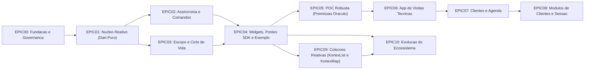

# Plano Mestre de Execução — Kortex (`v0.1.0`)

> **Responsável do Plano**: Denerson Nobre  
> **Referências**: [PRD.md](../product/PRD.md) · [SPEC.md](../architecture/SPEC.md) · [DESIGN.md](../architecture/DESIGN.md)

---

## 1. Grafo de Dependências (DAG de Precedência)

---

## 2. Matriz de Épicos (Paridade 1:1 com a DAG)

| ID | Épico | Dependências | Prioridade | Status | Arquivo |
| --- | --- | --- | --- | --- | --- |
| `EPIC00` | Fundação Técnica & Governança | Nenhuma | Crítica | `Concluído` | [epic-00-fundacao.md](epics/epic-00-fundacao.md) |
| `EPIC01` | Núcleo Reativo em Dart Puro | `EPIC00` | Crítica | `Concluído` | [epic-01-nucleo-reativo.md](epics/epic-01-nucleo-reativo.md) |
| `EPIC02` | Assincronia, Streams & Comandos | `EPIC01` | Alta | `Concluído` | [epic-02-assincronia.md](epics/epic-02-assincronia.md) |
| `EPIC03` | Escopo & Ciclo de Vida na Árvore | `EPIC01` | Crítica | `Concluído` | [epic-03-escopo.md](epics/epic-03-escopo.md) |
| `EPIC04` | Widgets, Pontes SDK & Exemplo | `EPIC02`, `EPIC03` | Alta | `Concluído` | [epic-04-widgets.md](epics/epic-04-widgets.md) |
| `EPIC05` | POC Robusta (Premissas Oráculo) | `EPIC04` | Alta | `Concluído` | [epic-05-poc-robusta.md](epics/epic-05-poc-robusta.md) |
| `EPIC06` | App de Visitas Técnicas | `EPIC05` | Alta | `Concluído` | [epic-06-app-visitas.md](epics/epic-06-app-visitas.md) |
| `EPIC07` | Clientes & Agenda | `EPIC06` | Alta | `Concluído` | [epic-07-clientes-agenda.md](epics/epic-07-clientes-agenda.md) |
| `EPIC08` | Módulos de Clientes & Sessão | `EPIC07` | Alta | `Concluído` | [epic-08-modulos-apoio.md](epics/epic-08-modulos-apoio.md) |
| `EPIC09` | Coleções Reativas (`KortexList` & `KortexMap`) | `EPIC04` | Alta | `Concluído` | [epic-09-colecoes-reativas.md](epics/epic-09-colecoes-reativas.md) |
| `EPIC10` | Evolução do Ecossistema Kortex | `EPIC04`, `EPIC09` | Alta | `Proposto` | [epic-10-evolucao-ecossistema.md](epics/epic-10-evolucao-ecossistema.md) |
---

## 3. Definition of Ready (DoR) & Definition of Done (DoD)

### DoR (para iniciar qualquer UC)
- Quarteto canônico do Gate Zero aprovado (`SPEC.md`, `DESIGN.md`, `docs/plan/README.md`, `epic-00-fundacao.md`).
- Épico predecessor na DAG com status `Concluído`.
- Fatia/UC possui User Story, critérios Gherkin (`Scenario Outline` + `Examples`) e escopo de arquivos definido.

### DoD (para concluir qualquer UC)
- Testes escritos sob TDD (Red-Before-Green) passando em `flutter test`.
- `flutter analyze` encerrando com `No issues found!` (zero warnings).
- Pureza `INV-05` respeitada em `lib/src/reactive/`.
- Documentação (`CHANGELOG.md`, `LEARNINGS.md`, `CHECKPOINT.md`, status do épico) atualizada no mesmo commit atômico.
